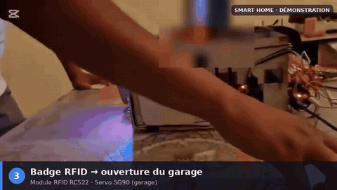
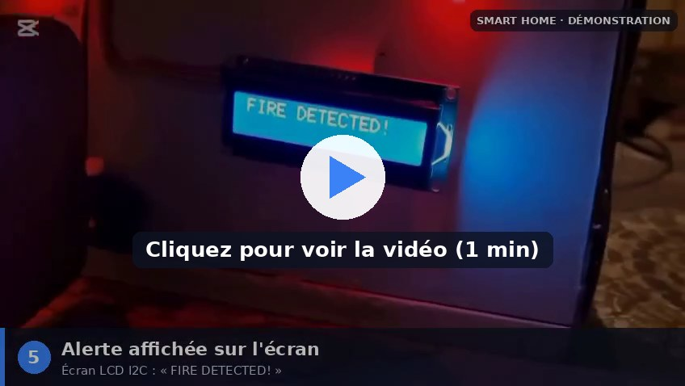
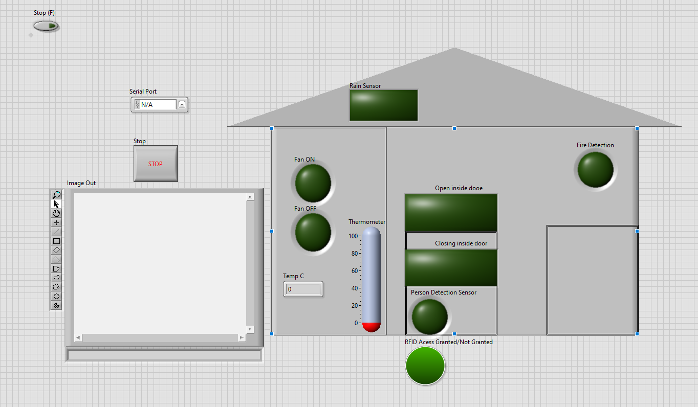
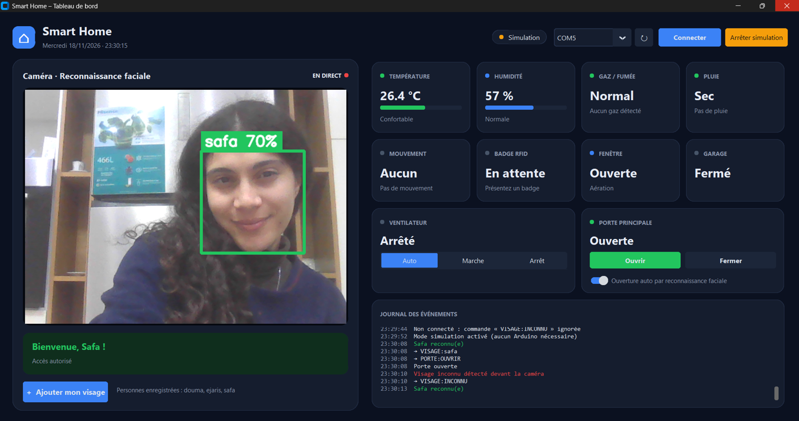
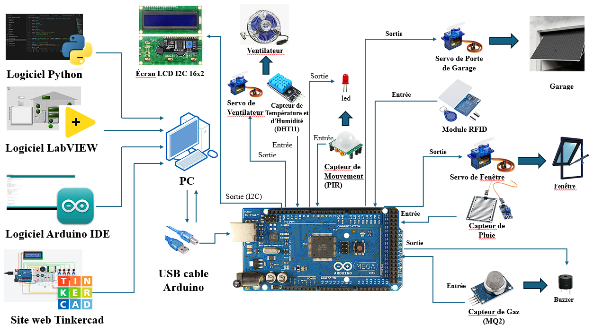

# 🏠 Smart Home – Maison intelligente

Prototype de maison intelligente : une **Arduino Mega 2560** gère les capteurs et les
actionneurs, et une **application Python** sur le PC affiche un tableau de bord et fait
la **reconnaissance faciale** pour ouvrir la porte. Les deux communiquent par câble USB.



---

##  Vidéo de démonstration

[](https://github.com/safadouma1/Smart-Home/raw/main/docs/videos/demo_maquette_reelle.mp4)

▶ **[Voir la vidéo complète](https://github.com/safadouma1/Smart-Home/raw/main/docs/videos/demo_maquette_reelle.mp4)**.
Chaque étape et chaque capteur sont indiqués à l'écran.

| Temps | Étape | Composants |
|---|---|---|
| 0:00 | Démarrage du système | Arduino Mega, écran LCD I2C, LEDs |
| 0:05 | Reconnaissance faciale → ouverture de la porte | Caméra du PC + Python, servo SG90 |
| 0:08 | Badge RFID → ouverture du garage | Module RFID RC522, servo SG90 |
| 0:17 | Câblage et vue d'ensemble | Arduino Mega, capteurs et actionneurs |
| 0:28 | Détection de gaz et alerte « FIRE DETECTED! » | Capteur MQ2, buzzer, LCD |
| 0:39 | Intérieur de la maison | Pièces de la maquette, LEDs |
| 0:44 | Température en hausse (24,8 → 35,2 °C) | Capteur DHT11, LCD |
| 0:56 | Ventilateur activé (seuil 30 °C dépassé) | Servo SG90, capteur PIR |

---

##  Application : tableau de bord et reconnaissance faciale

L'interface LabVIEW d'origine a été remplacée par une application Python.

| Avant : LabVIEW | Après : Python |
|---|---|
|  |  |


**Fonctionnalités :**
-  Caméra en direct avec le nom et le pourcentage de confiance de la personne reconnue
-  Bouton **« Ajouter mon visage »** : 200 photos sont prises, puis le modèle se réentraîne automatiquement
-  Température, humidité, gaz, pluie, mouvement, badge RFID, fenêtre et garage en temps réel
-  Ventilateur (Auto / Marche / Arrêt) et porte (Ouvrir / Fermer) commandés depuis l'application
-  Journal des événements horodaté
-  Mode **Simulation** pour tester sans Arduino

---

##  Fonctionnement de la maison



| Pièce | Capteur | Action |
|---|---|---|
| Salon | DHT11 (température, humidité) | Affichage sur le LCD ; ventilateur automatique à partir de 30 °C |
| Cuisine | MQ2 (gaz / fumée) | Buzzer + alerte sur le LCD et dans l'application |
| Fenêtre | Capteur de pluie | Fermeture automatique de la fenêtre |
| Couloir | PIR (mouvement) | LED allumée |
| Garage | Module RFID | Ouverture pendant 5 s avec un badge autorisé |
| Porte d'entrée | Caméra du PC | Ouverture quand un visage connu est reconnu |

### Broches (Arduino Mega 2560)

| Composant | Broche |
|---|---|
| MQ2 (gaz) | 5 |
| Capteur de pluie | 2 |
| DHT11 | A0 |
| PIR | 7 |
| RFID RC522 | SS 53, RST 49, MOSI 51, MISO 50, SCK 52 |
| Buzzer / LED | 6 / 8 |
| Servos fenêtre / ventilateur / porte / garage | 9 / 3 / 10 / 4 |
| LCD I2C 16x2 | SDA 20, SCL 21 |

---

##  Structure du projet

```
├── arduino/smart_home/       code C++ de la carte Arduino Mega
│   ├── smart_home.ino
│   └── config.h              broches, seuils, angles des servos, badges autorisés
├── python/                   application du PC
│   ├── main.py               point d'entrée
│   ├── requirements.txt
│   ├── smarthome/            interface, caméra, reconnaissance, communication série
│   ├── outils/               scripts en ligne de commande (facultatifs)
│   └── data/                 photos et modèle (créés en local, non publiés)
└── docs/                     rapport, présentations, vidéos, images
```

---

##  Installation et utilisation

### 1. Arduino
1. Ouvrez `arduino/smart_home/smart_home.ino` dans l'Arduino IDE.
2. Installez les bibliothèques : **DHT sensor library** (Adafruit), **Adafruit Unified Sensor**,
   **LiquidCrystal I2C** (Frank de Brabander) et **MFRC522**.
3. Sélectionnez la carte **Arduino Mega 2560** et le bon port, puis téléversez.

### 2. Application Python (Windows, **Python 3.12**)
```
cd python
py -3.12 -m pip install -r requirements.txt
py -3.12 main.py
```
- Avec l'Arduino : choisissez le port (ex. COM5), puis cliquez sur **Connecter**. Fermez d'abord le moniteur série de l'Arduino IDE.
- Sans Arduino : cliquez sur **Simulation**.

### 3. Ajouter un visage
Cliquez sur **« + Ajouter mon visage »**, tapez un prénom et regardez la caméra en tournant
légèrement la tête. Il faut **au moins 2 personnes** enregistrées pour que la reconnaissance
fonctionne.

>  Les photos des visages et le modèle entraîné restent sur le PC : ils ne sont pas publiés dans ce dépôt.

---

##  Protocole série (Arduino ⇄ PC, 9600 bauds)

- **Arduino → PC**, toutes les 500 ms :
  `T:25.3;H:60;GAZ:0;PLUIE:0;PIR:1;FAN:0;PORTE:0;FENETRE:1;GARAGE:0;RFID:0`
- **PC → Arduino** : `PORTE:OUVRIR`, `PORTE:FERMER`, `FAN:ON`, `FAN:OFF`, `FAN:AUTO`,
  `VISAGE:<nom>`, `VISAGE:INCONNU`

---

##  Technologies

Arduino (C++) · Python 3.12 · OpenCV · MediaPipe · scikit-learn · CustomTkinter · PySerial · Tinkercad
